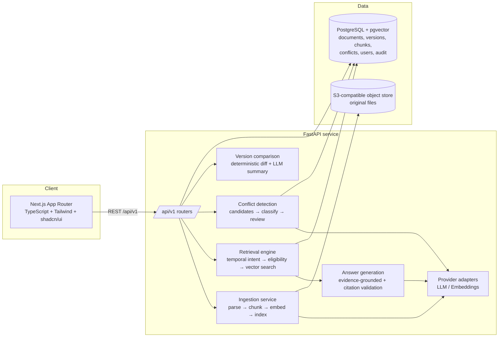

# VersionWise AI — Architecture

## System overview



## Core principle: two clocks

Every document version carries **effective time** (`effective_from`,
`effective_until`) — when its content is/was actually in force — stored as a
half-open interval `[from, until)` with NULL meaning open-ended. Upload time is
recorded separately (`uploaded_at`). Retrieval always filters on effective time
plus approval status plus permissions *before* semantic ranking.

## Backend module map

```
app/
├── api/v1/            # routers; thin controllers, Pydantic in/out
├── core/              # settings, errors, security, logging
├── db/                # engine, session, base
├── models/            # SQLAlchemy ORM models
├── schemas/           # Pydantic request/response schemas
├── repositories/      # data access; all SQL lives here
├── services/          # business logic (documents, versions, approvals)
├── ingestion/         # parsers (pdf/docx/txt), chunker, embedding pipeline
├── retrieval/         # temporal intent, eligibility, vector search, evidence
├── conflict_detection/# candidate mining, LLM classification, review
└── main.py            # app factory, middleware, exception handlers
```

## Retrieval pipeline (Phase 6 preview)

1. **Temporal intent parse** — explicit date/range, "current", "compare", or
   default → as-of date.
2. **Eligibility filter (SQL)** — permission + `status='approved'` +
   `ingestion_status='completed'` + effective interval contains the as-of date.
   Overlapping approved intervals on one logical document → ambiguity flag, not
   a silent pick.
3. **Semantic rank** — pgvector cosine over eligible chunks only.
4. **Evidence objects** — chunk + doc title + version + interval + page + score.
5. **Grounded generation** — model answers only from evidence; backend, not the
   model, decides authoritative versions.
6. **Response validation** — every cited chunk must exist in the evidence set
   and pass permission/temporal checks.

## Data flow: ingestion

Upload → validate type/size → SHA-256 hash → object store → parse (page-aware)
→ chunk (heading/paragraph aware, configurable size/overlap) → batch embed →
transactional insert of chunks → version `ingestion_status=completed`.
A version is retrieval-eligible only when `approved` **and** `completed`.
Retries delete-and-rebuild that version's chunks (idempotent).

## Security model

- Backend enforces authZ on every request; document-level permissions joined in
  retrieval SQL — never retrieve-then-filter-in-prompt.
- Uploaded documents are untrusted input: content is delimited in prompts and
  can never override system instructions (prompt-injection defense, Phase 12).
- Secrets only via env vars; `.env` gitignored.
